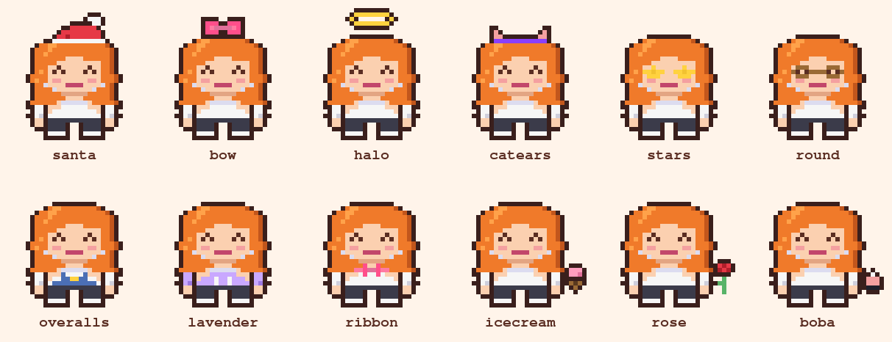
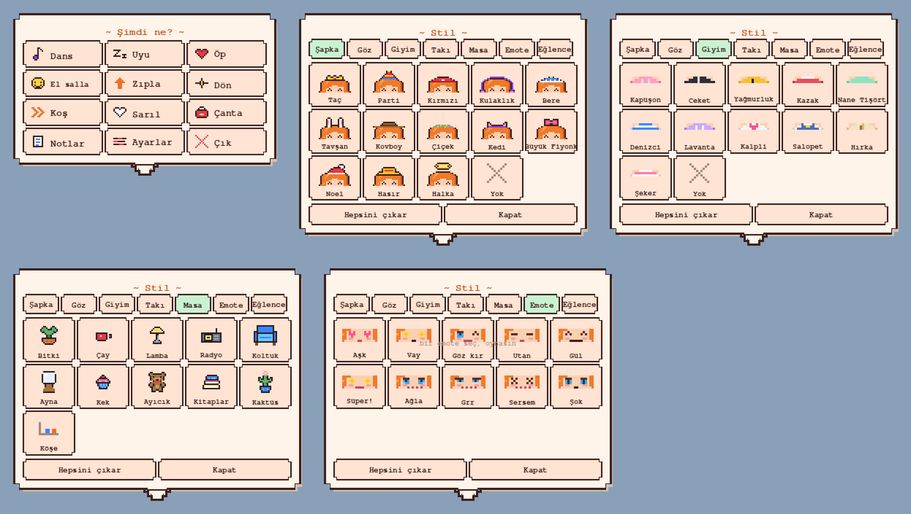
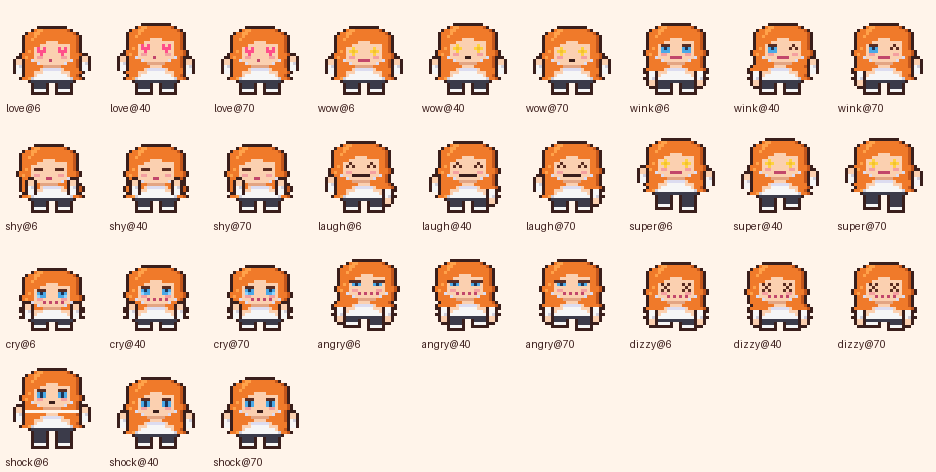

<p align="center"></p>

# Pocket Karolina ♥

**A tiny pixel girl who lives on your desktop.** Pocket Karolina walks around your screen, climbs onto your windows,
sits in her armchair, drinks tea, plays with her frog and her dog Lila, reminds you of things, and can be controlled
from a phone. Made with love as a gift.

Single file · Python 3 + tkinter only · no dependencies · Windows / macOS / Linux

## Quick start

```bash
python pocket_karolina_v12.py
```

On Windows you can double-click `start_pocket_karolina.bat` instead. The launcher shows any error and writes it to
`pet_error.log`, so the window never just disappears.

| Action | What happens |
|---|---|
| Click | Cuddle (raises mood and affection) |
| Double-click | Dance |
| Drag and release | Pick her up and throw her (throw her up fast and she swears in Polish) |
| Right-click | Action menu: Dance, Sleep, Kiss, Wave, Jump, Spin, Run, Hug, Bag, Notes, Settings |

## Features

- **Alive.** She walks, runs, dances, sleeps, stretches, gets bored, sulks when ignored and forgives you when you come
  back. Mood, energy and affection are hidden stats that drive her behaviour.
- **Window climbing.** She hops onto the edge of your open windows and dangles her legs (Windows built in, macOS with
  pyobjc, Linux/X11 with wmctrl; silently disabled elsewhere).
- **Bag.** 13 hats, 6 glasses, 11 outfits, 8 neck accessories and held items (coffee, boba, ice cream, rose, lollipop,
  balloon). Hover to preview, click to wear.
- **Emotes.** Love, wow, wink, shy, laugh, super, cry, grr, dizzy, shock. She also does them on her own now and then.
- **Desk props.** Plant, tea mug, lamp, radio, armchair, mirror, cupcake, teddy, books, cactus. She walks over and uses
  them: sniffs the plant, sips tea, hugs the teddy, pokes the cactus and says "ouch".
- **Pals.** Frog, and Lila the pinscher on a leash. Lila can also play fetch.
- **Games.** Rock paper scissors (against her, or against someone on the phone).
- **Notes and reminders.** Type `18:30 call mom` and she reminds you at 18:30.
- **Languages.** English, Turkish and Polish for the whole UI and every speech line.
- **Calm mode.** Less walking, no chatter, no random emotes, for when you need to focus.
- **Safe saves.** Everything is stored in `save.json`, with an automatic `.bak` backup and atomic writes.



### Bag and menus



### Emotes



### Desk props


## Phone remote

Open **Settings > Phone** to start a tiny web server on your local network, then **Settings > Link** to show the address.
Open that link on a phone on the same Wi-Fi. From the phone you can:

- chat with her and send notes and reminders,
- change and save outfits (with a live preview of the character),
- trigger actions and emotes,
- play mini games: a rock paper scissors duel against the person at the PC, tic-tac-toe, and memory.


Security: the link contains a secret token, wrong guesses are rate limited, and the phone can only trigger a fixed
whitelist of actions. It is meant for your local network only; do not expose the port to the internet.

## Files

| File | Purpose |
|---|---|
| `pocket_karolina_v12.py` | The whole app |
| `start_pocket_karolina.py` / `.bat` | Launcher that picks the newest `pocket_karolina_v*.py` and reports errors |
| `save.json` | Created on first run (ignored by git) |

## Notes

- Transparent windows work best on Windows.
- All pixel art is generated in code from character grids, so there are no image assets to ship.

---

*Türkçe özet:* Masaüstünde yaşayan küçük piksel Karolina. `python pocket_karolina_v12.py` ile çalıştır; sağ tıkla menüyü aç,
Settings > Phone ile telefondan kontrol et.
