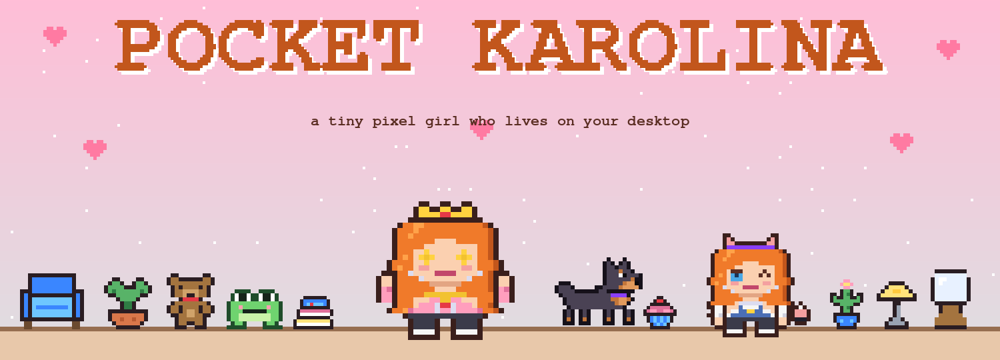
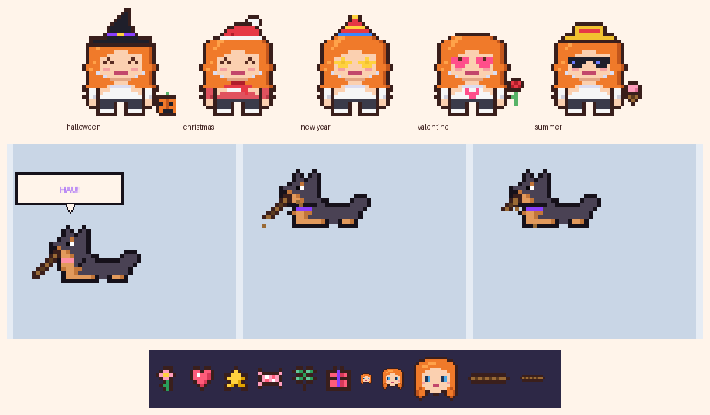
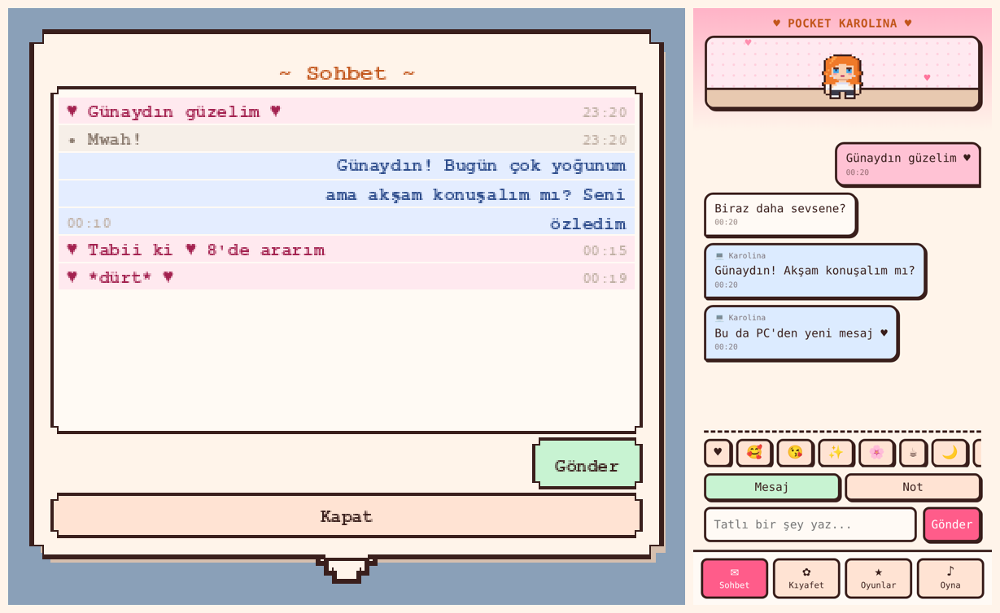
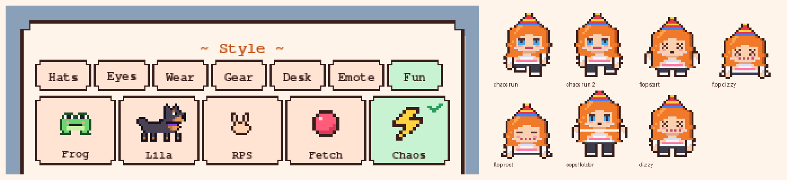
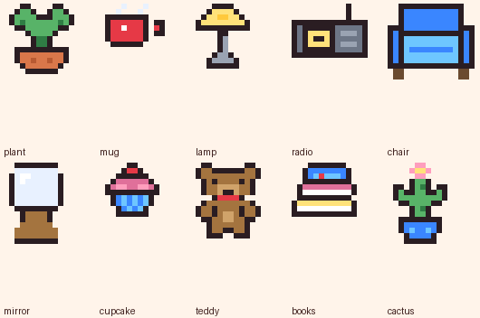
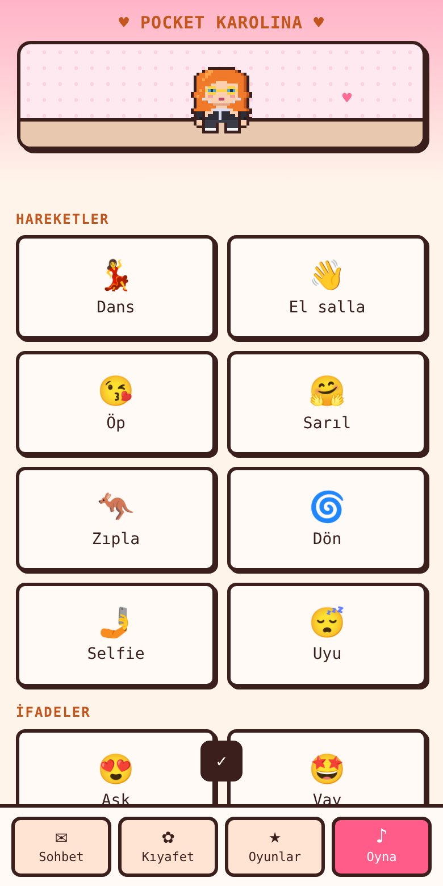

<p align="center"></p>

# Pocket Karolina ♥

**A tiny pixel girl who lives on your desktop.** Pocket Karolina walks around your screen, climbs onto your windows,
sits in her armchair, drinks tea, plays with her frog and her dog Lila, reminds you of things, and can be controlled
from a phone. Made with love as a gift.

Single file · Python 3 + tkinter only · no dependencies · Windows / macOS / Linux

## Quick start

```bash
python pocket_karolina_v14.py
```

On Windows you can double-click `start_pocket_karolina.bat` instead. The launcher shows any error and writes it to
`pet_error.log`, so the window never just disappears.

### Start automatically with Windows (no console window)

Double-click `install_autostart.bat` once. From then on she appears by herself every time you log in to Windows,
without the black console window, always running the newest `pocket_karolina_v*.py` in this folder. It adds a small
`PocketKarolina.vbs` to your Startup folder (no admin rights needed). `uninstall_autostart.bat` removes it.
Only one copy runs at a time, so opening her again by hand while she is already running does nothing.

| Action | What happens |
|---|---|
| Click | Cuddle (raises mood and affection) |
| Double-click | Dance |
| Drag and release | Pick her up and throw her (throw her up fast and she swears in Polish) |
| Right-click | Action menu: Dance, Sleep, Kiss, Wave, Jump, Spin, Run, Hug, Bag, Notes, Settings |

## Features

- **Alive.** She walks, runs, dances, sleeps, stretches, gets bored, sulks when ignored and forgives you when you come
  back. Mood, energy and affection are hidden stats that drive her behaviour.
- **Window climbing.** She hops onto the edge of your open windows and dangles her legs (Windows built in, macOS with
  pyobjc, Linux/X11 with wmctrl; silently disabled elsewhere).
- **Bag.** 13 hats, 6 glasses, 11 outfits, 8 neck accessories and held items (coffee, boba, ice cream, rose, lollipop,
  balloon). Hover to preview, click to wear.
- **Emotes.** Love, wow, wink, shy, laugh, super, cry, grr, dizzy, shock. She also does them on her own now and then.
- **Desk props.** Plant, tea mug, lamp, radio, armchair, mirror, cupcake, teddy, books, cactus. She walks over and uses
  them: sniffs the plant, sips tea, hugs the teddy, pokes the cactus and says "ouch".
- **Pals.** Frog, and Lila the pinscher on a leash. Lila can also play fetch.
- **Games.** Rock paper scissors (against her, or against someone on the phone).
- **Chaos mode.** Bag > Fun > Chaos (or the phone). For 30 to 45 seconds she sprints around, bonks into the
  screen edges, knocks her desk props flying, clicks through her own wardrobe panel and changes clothes like crazy,
  and opens your Downloads folder 2 or 3 times ("oops!"). Then she flops over, dizzy, and tidies her outfit a bit later.
  Click her to stop it early. It never clicks outside the app and never opens anything except Downloads.
- **Treats for Lila.** Bag > Fun > Treat (or the phone): she throws a chew, Lila sprints to it, lies down and gnaws it
  until it is gone, crumbs flying.
- **Chat.** Right-click > Chat to write back to the phone. Phone messages appear on the left, your replies show up on
  the phone as "Karolina", with a little notification.
- **Poke from the phone.** One tap and she jumps on the desktop saying someone is thinking of you.
- **Game mode.** Right-click > Game mode hides everything into a tiny Karolina head next to the clock; click it to
  bring her back. With Settings > Auto hide on, she also disappears by herself while a fullscreen game or video is in
  front, and comes back when you leave it. Starting the app again also brings her back.
- **Desktop surprises.** Now and then a little flower, heart, star, candy, clover or gift pops up on the floor. Click it
  (or let her walk over it) to collect it; the count shows in Bag > Fun.
- **Seasonal costumes.** New Year, Valentine's Day, summer, Halloween (witch hat and pumpkin) and Christmas. She dresses
  up once per season and changes back afterwards unless you changed her outfit yourself.
- **Notes and reminders.** Type `18:30 call mom` and she reminds you at 18:30.
- **Languages.** English, Turkish and Polish for the whole UI and every speech line.
- **Calm mode.** Less walking, no chatter, no random emotes, for when you need to focus.
- **Safe saves.** Everything is stored in `save.json`, with an automatic `.bak` backup and atomic writes.


### Bag and menus


### Emotes


### New in v14





### Chaos mode



### Desk props



## Phone remote

Open **Settings > Phone** to start a tiny web server on your local network, then **Settings > Link** to show the address.
Open that link on a phone on the same Wi-Fi. From the phone you can:

- chat with her and send notes and reminders,
- change and save outfits (with a live preview of the character),
- poke her, throw Lila a treat, trigger actions and emotes (including Chaos!),
- play mini games: a rock paper scissors duel against the person at the PC, tic-tac-toe, and memory.



Security: the link contains a secret token, wrong guesses are rate limited, and the phone can only trigger a fixed
whitelist of actions. It is meant for your local network only; do not expose the port to the internet.

## Files

| File | Purpose |
|---|---|
| `pocket_karolina_v14.py` | The whole app |
| `start_pocket_karolina.py` / `.bat` | Launcher that picks the newest `pocket_karolina_v*.py` and reports errors |
| `autostart.py`, `install_autostart.bat`, `uninstall_autostart.bat` | Start with Windows without a console window |
| `save.json` | Created on first run (ignored by git) |

## Notes

- Transparent windows work best on Windows.
- All pixel art is generated in code from character grids, so there are no image assets to ship.

---

*Türkçe özet:* Masaüstünde yaşayan küçük piksel Karolina. `python pocket_karolina_v14.py` ile çalıştır; sağ tıkla menüyü aç,
Settings > Phone ile telefondan kontrol et. Yeni: kaos modu, Lila'ya kuru et, sohbet, oyun modu, sürprizler ve mevsimlik kostümler. Windows açılınca kendiliğinden başlasın diye bir kere install_autostart.bat'a çift tıkla.
